# Staff Portal for Home Assistant

A Home Assistant add-on that gives your staff a branded app, on their phones and at front-desk
computers, showing only the devices their role allows. You manage everything from a
**Staff Access** dashboard in the Home Assistant sidebar. Staff never get a Home Assistant
login.

<p align="center">
  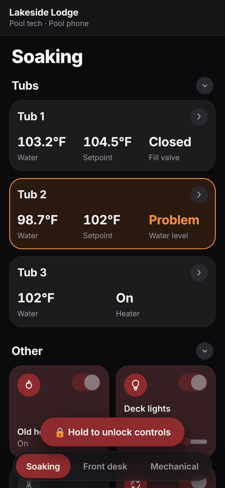
  &nbsp;
  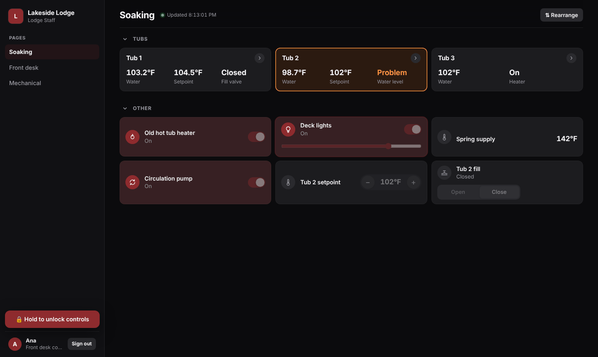
</p>

Built for properties like hotels, resorts and spas, where maintenance, pool and front-desk staff
need a few controls (tub setpoints, fill valves, lights, door locks) without access to the whole
system.

## Features

### Staff app (phones and computers)

- **Phones:** set up by scanning a QR code, installed to the home screen with your logo and name,
  and signed in until you revoke them.
- **Computers** such as front-desk PCs get a desktop layout:
  - a sidebar with the pages and keyboard shortcuts (1 to 9);
  - compact device rows;
  - card details in a side panel.

  They're set up with a link instead of a QR code.
- **Shared devices:** each person taps or clicks their name and enters their own PIN, so every
  action is recorded under their name, or (per device) just types their PIN with no names
  shown. People are signed out after an idle time you set.
- **Hold to unlock controls:** controls stay locked until someone presses and holds, and lock
  again after 10 quiet minutes. Checking a temperature can't switch something by accident.
- **Group cards** (such as "Tub 1") show key readings at a glance and open into a screen with all
  of its readings and controls. Named dividers split that screen into sections.
- **Foldable headings:** a folded heading shows how many cards it holds, and turns orange if one
  needs attention.
- **Personal arrangement:** staff can drag their own tabs and cards into the order that suits
  them, without changing anyone else's.
- **Dark and light mode**, following the device.

### Access control

- **Roles** give each device **Hidden**, **View** or **Control**, one by one or a whole area at
  a time. Roles can be duplicated to make variations.
- **Areas:** group devices your way ("Soaking area", "Mechanical"), from whole Home Assistant
  areas and/or single devices.
- **Layout overrides:** an item on a page can raise or lower access for every device that shows
  that page.
- **The add-on enforces all access, not just the screen.** Every action is checked against the
  device's role and validated, with sensible ranges for setpoints and the entity's own options
  for dropdowns.
- **Connecteam (optional):** add staff from your Connecteam user list with their kiosk code as
  their PIN, and only let them sign in while they're clocked in.
- **Activity log** of every action and every blocked attempt. Actions can also show in Home
  Assistant's logbook, or be credited to a linked Home Assistant user.

### Admin dashboard (Home Assistant sidebar → Staff Access)

- **Phones & computers:** add, revoke, re-pair, unlock, link to a Home Assistant user, and choose
  which pages each one shows.
- **Staff:** people with personal PINs for shared devices.
- **Layout editor:** pages, headings, single devices, whole areas and group cards. Drag to
  reorder, duplicate items or whole pages, and set per-item access.
- **Branding:** property name, home-screen name, brand color and logo.
- **Backup tab:**
  - a full backup and restore, with automatic undo copies;
  - export and import of the layout, roles and staff on their own.

### Security

- Only Home Assistant **administrators** can open the dashboard.
- **Staff devices** hold a random token, which is stored hashed on the server.
- **PINs** are scrambled with scrypt and a salt, and never stored readable.
- **Wrong PINs** lock a person temporarily, or the device after repeated failures, including a
  daily limit that slow, paced guessing can't get around.
- **Speed limits** apply to sign-ins, actions, failed setup codes and error reports, and idle or
  slow connections are closed.
- **Strict security headers:** a Content Security Policy and protection against cross-site
  requests.
- **Optional:** require a PIN on every device, and only allow phones in through your Cloudflare
  Tunnel (with the tunnel's address detected for you).
- **Backup files** never include Home Assistant sign-ins, pending setup codes or the Connecteam
  secret. A restore only keeps phones signed in that this system set up and hasn't revoked, so an
  old or edited backup can't bring back or add a working phone.

## Screenshots

| | |
|---|---|
| 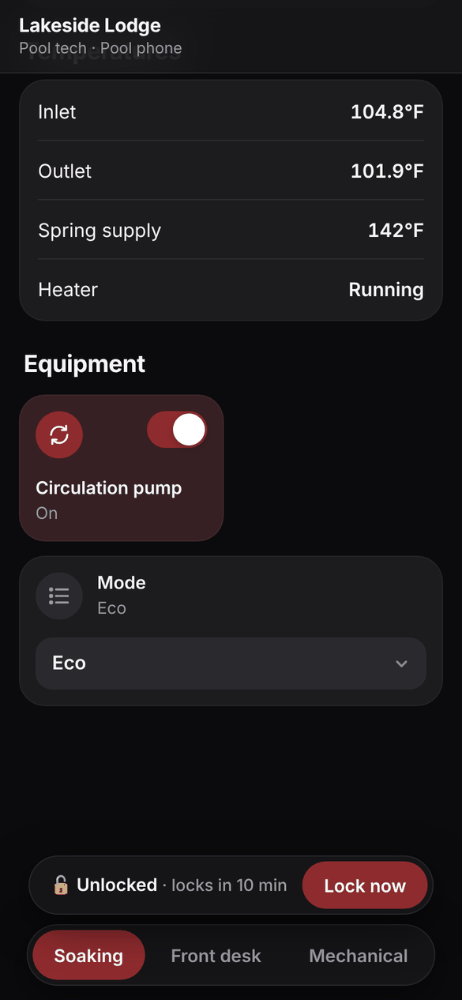 | 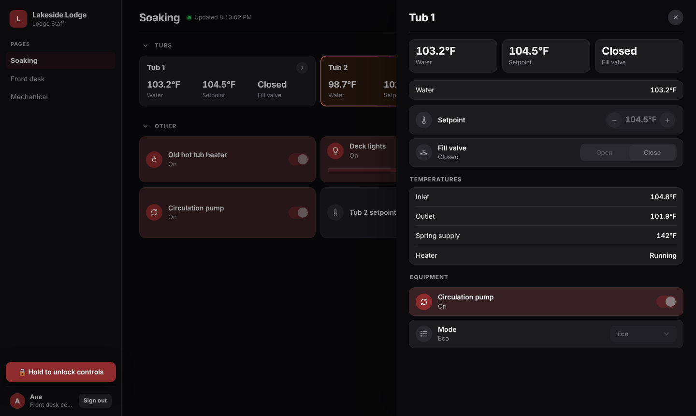 |
| Phone: a group card's readings and controls, unlocked | Computer: card details open in a side panel |
| 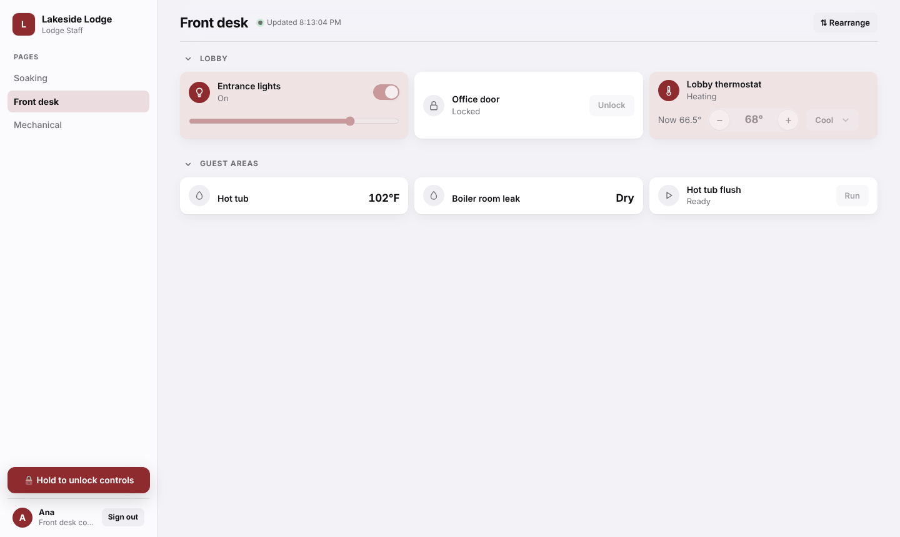 | 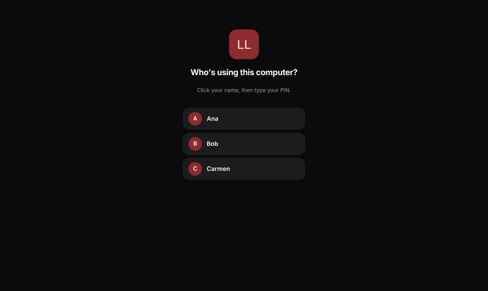 |
| Computer: a front-desk page in light mode | Shared computer: each person signs in with their PIN |
| 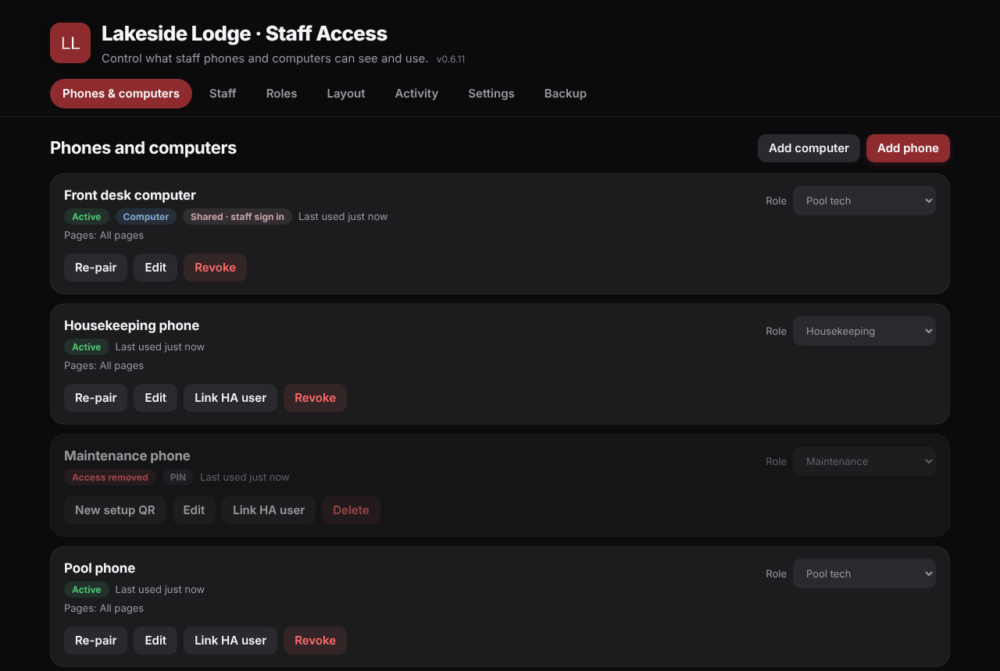 | 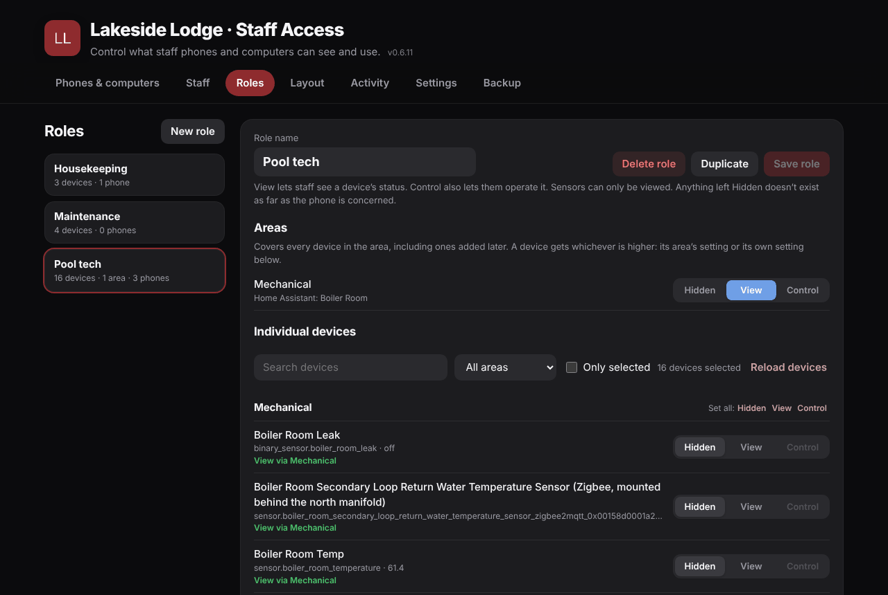 |
| Dashboard: phones and computers | Dashboard: a role's access by area and device |
| 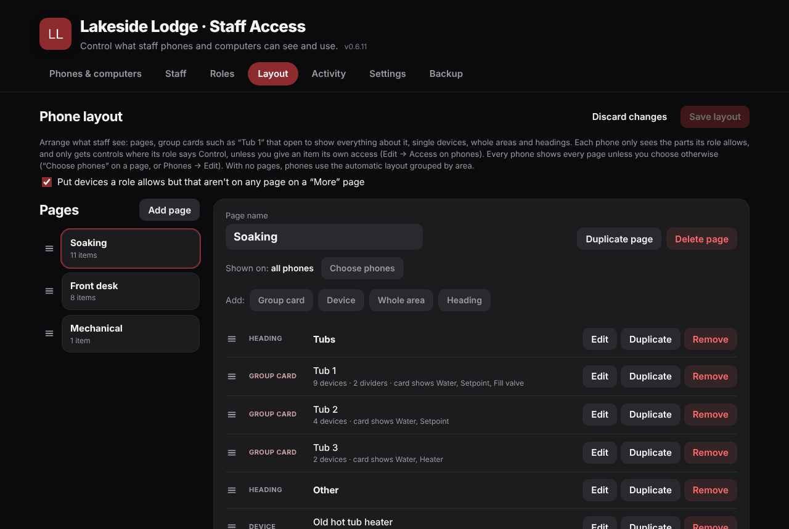 | 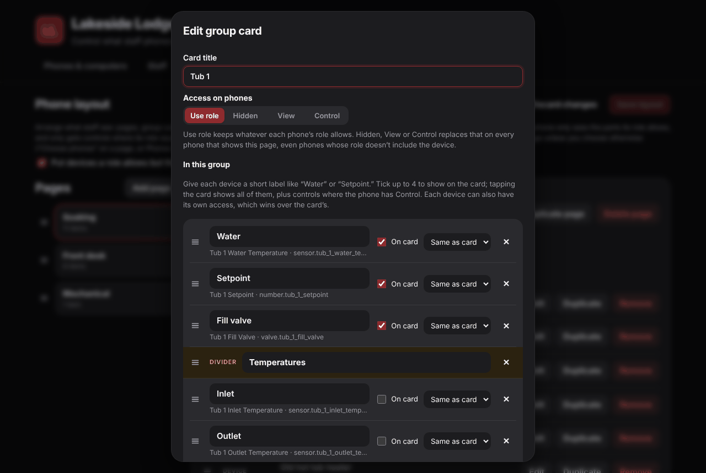 |
| Dashboard: the layout editor | Dashboard: a group card with dividers and per-device access |
| 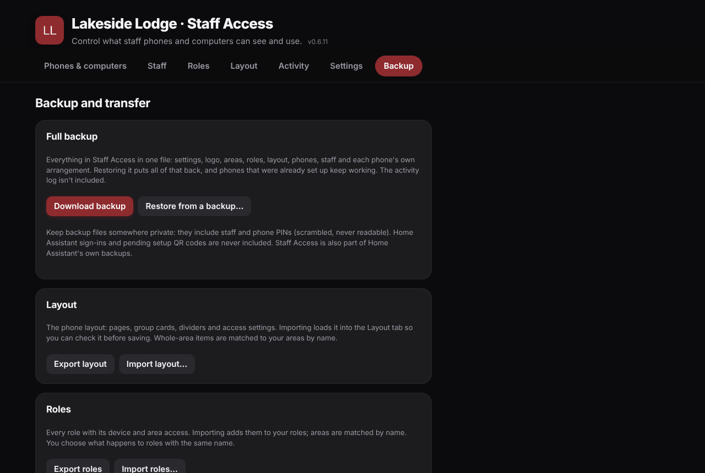 | |
| Dashboard: backup, restore, export and import | |

The screenshots use demo data.

## Getting started

You need Home Assistant OS (or Supervised) to install it as an add-on. To make the staff app
reachable from outside, a Cloudflare Tunnel (or another reverse proxy with HTTPS) is
recommended.

1. In Home Assistant go to **Settings → Add-ons → Add-on Store → ⋮ → Repositories**, and add
   `https://github.com/liamdayan/ha-staff-portal`.
2. Install **Staff Portal**, start it, and turn on **Show in sidebar**.
3. Point your tunnel at port **8787**, and enter its https address under
   **Staff Access → Settings**.
4. Create a role, add a phone or computer, and scan the QR code or open the setup link.

The full guide is in [staff_portal/DOCS.md](staff_portal/DOCS.md), which is also shown on the
add-on's **Documentation** tab. It covers tunnels, roles, areas, layouts, shared devices, locked
controls, linking Home Assistant users, security settings and backups.

## How it works

```
Phones / computers ──https──▶ Cloudflare Tunnel ──▶ Staff Portal :8787 (staff app + API)
                                                         │  checks role, PIN, limits
                                                         ▼
Home Assistant sidebar ──ingress──▶ Staff Access :8099 ──▶ Home Assistant API
```

The add-on runs two small web servers in one process. The staff app talks only to the add-on,
never to Home Assistant directly. The add-on holds the Home Assistant connection, decides what
each device may see and do, and sends allowed actions on. Everything is stored in SQLite in the
add-on's `/data` folder, which Home Assistant includes in its backups.

## Repository layout

```
repository.yaml              Home Assistant add-on repository manifest
docs/screenshots/            Images used in this README
staff_portal/
  config.yaml                Add-on manifest (ingress for the dashboard, port 8787 for staff)
  Dockerfile
  DOCS.md                    Setup guide (shown in the add-on's Documentation tab)
  CHANGELOG.md               What changed in each version
  app/
    main.py                  Web servers, sign-in, admin and staff APIs, security checks
    permissions.py           What each device type allows, and validation of every action
    layout.py                Pages, group cards, per-item access, per-device arrangement
    transfer.py              Export, import, backup and restore
    connecteam.py            Connecteam users and time clock (OAuth 2.0)
    db.py                    SQLite storage
    ha.py                    Home Assistant REST and WebSocket client
    branding.py              Logo handling and home-screen icons
    admin/                   Admin dashboard (plain HTML, JS and CSS; no build step)
    staff/                   Staff app (plain HTML, JS and CSS; no build step)
```

## Local development

```sh
pip install -r staff_portal/requirements.txt
cd staff_portal/app
DATA_DIR=./.dev-data HA_URL=http://homeassistant.local:8123 HA_TOKEN=<long-lived token> \
  ADMIN_ALLOWED_IPS=127.0.0.1 python3 main.py
```

Admin dashboard: http://127.0.0.1:8099 · Staff app: http://127.0.0.1:8787

Outside Home Assistant OS, the dashboard only accepts connections from the addresses in
`ADMIN_ALLOWED_IPS`, so keep it behind something you trust. See "Running without Home Assistant
OS" in [DOCS.md](staff_portal/DOCS.md).

## Versions

The add-on is still under 1.0 while features settle. Each release is listed in
[CHANGELOG.md](staff_portal/CHANGELOG.md), which Home Assistant also shows on the add-on page.

## License

MIT. See [LICENSE](LICENSE). Copyright (c) 2026 Hot Lake Springs Resort.
